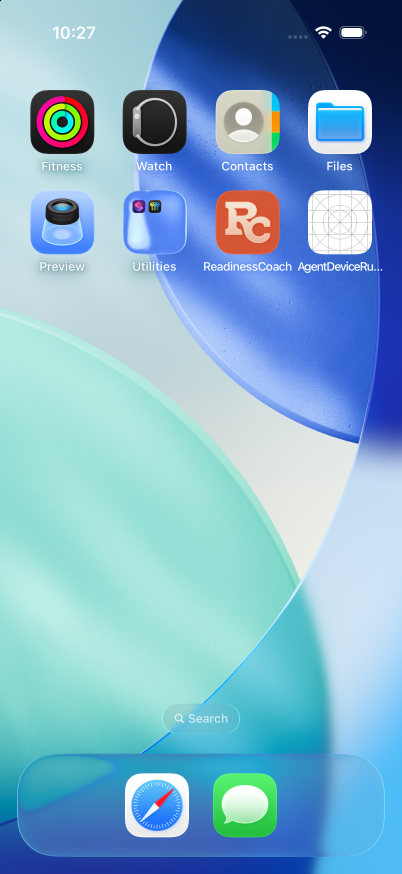
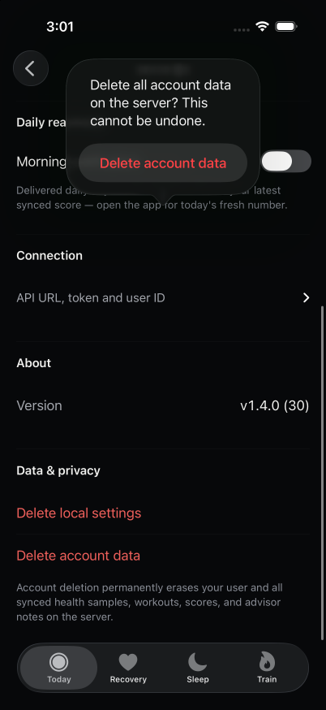
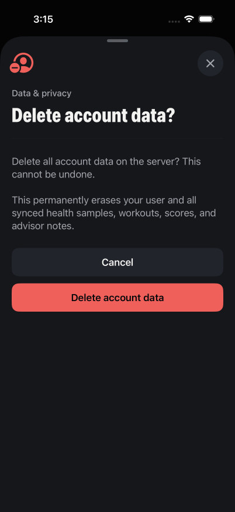
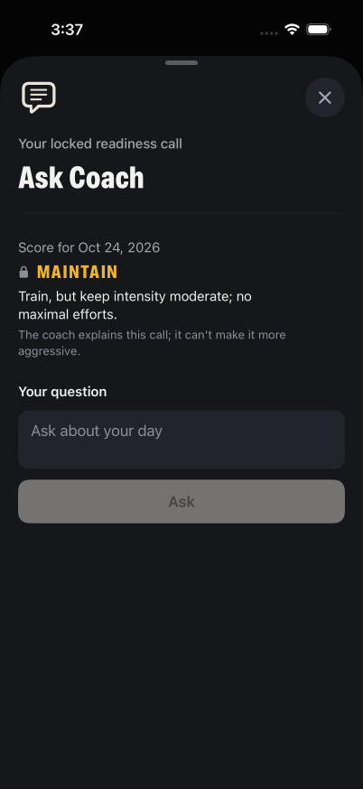
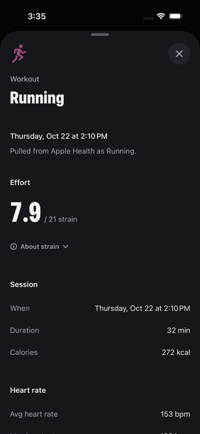
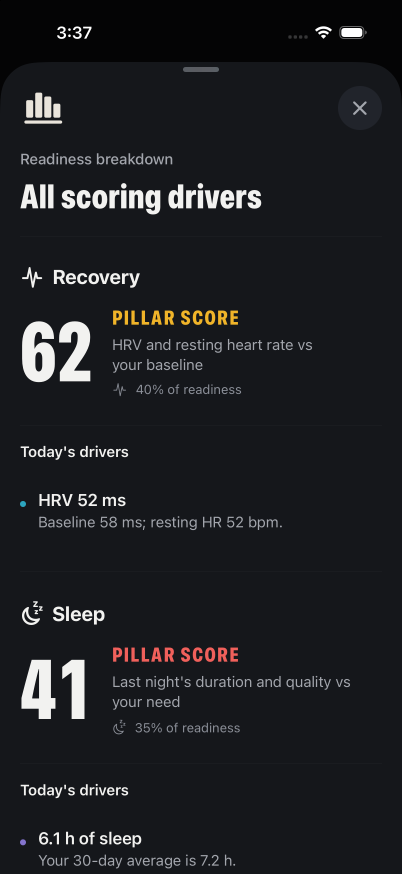
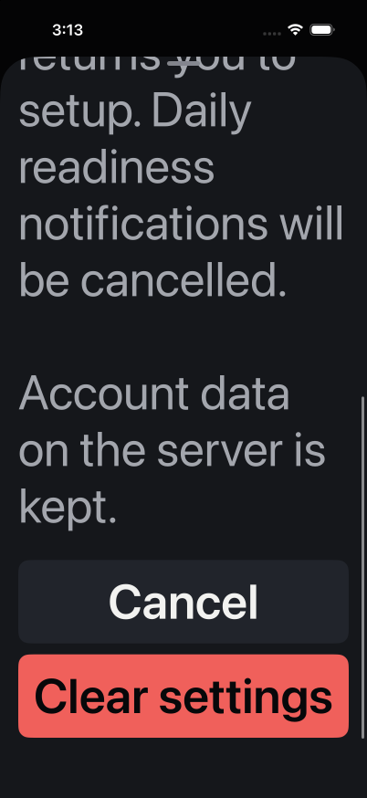

# Logo and modal verification

The new icon is an opaque 1024 × 1024 PNG. It was generated with the built-in image-generation tool and packaged with `sips`; the exact prompt and asset location are in [icon-prompt.md](icon-prompt.md). Its silhouette was inspected at 60 px and on the simulator Home Screen.

| Previous confirmation | New confirmation |
| --- | --- |
|  |  |

| Ask Coach | Workout details |
| --- | --- |
|  |  |

The full assembled iOS suite passed 209 tests. The final input refinements passed all eight affected support-screen tests. Generic simulator and signed physical-device builds succeeded; the device artifact passed strict signature verification. Independent Claude Opus 5.5 reviews approved the new modal flows and native input integration. The direct Claude provider reached its rate limit; the completed reviews used the same model through Cursor. Better Design MCP guidance remained quota-blocked; no MCP approval is claimed.

Runtime checks used synthetic local fixture data only. They covered the Home Screen icon, scoring drivers and all weights, workout details, default and largest text layouts, Ask keyboard Send, and destructive confirmations. Cancel generated no DELETE request. Confirming fixture account deletion generated exactly one DELETE and returned cleanly to onboarding. The simulator was then restored to its local fixture configuration. Native Ask Send generated exactly one POST, dismissed the keyboard and showed the fixture answer while retaining the locked decision. UIKit delegate tests also cover submission from the middle of a draft and allowing pasted paragraphs.

Health-error presentation uses a captured message in an item-based native sheet so dismissal cannot replace its text. The iOS Health permission prompt was observed and remains system-controlled. An actual Health authorization error was not induced; VoiceOver audio, hardware-keyboard Escape and physical IME input were not manually verified. Labels, escape actions, composition handling and layouts were checked in code and simulator accessibility snapshots.

Version **1.4.1 (32)** was installed and launched on Shawn's physical iPhone after terminating the previous process. Device metadata confirms the installed version, new bundle location and running process. The phone's final visual appearance and offline/full HealthKit sync results require user observation; simulator results do not establish those outcomes.

## Selected icon revision

Shawn selected the warm orange RC monogram after comparing three generated concepts. This revision changes only the icon, its provenance and screenshots, and the build number. The opaque 1024 × 1024 asset passed dimension and alpha checks. Simulator and signed physical-device builds succeeded; the signed app passed strict signature verification. The simulator Home Screen above shows the RC mark under the native mask. Physical-device metadata confirms 1.4.1 (32) was installed, and launch succeeded. The app was not running on the phone before installation; the simulator app was stopped before replacing its build. The earlier behavior tests and independent reviews cover the unchanged modal implementation.
