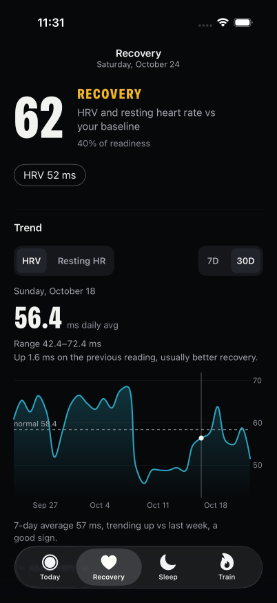
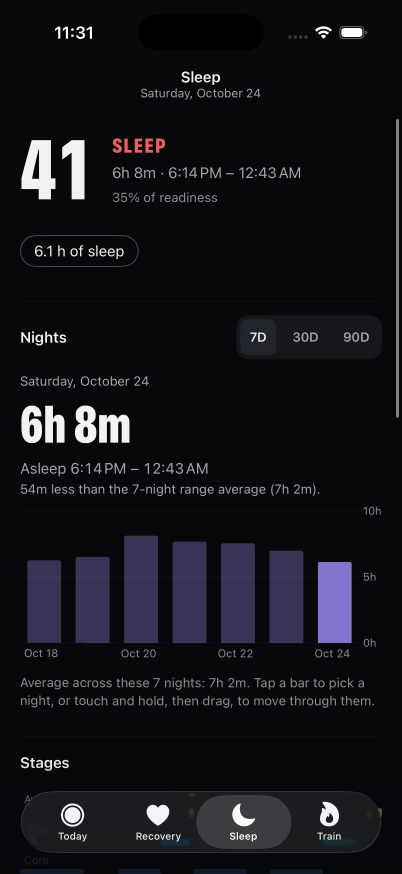
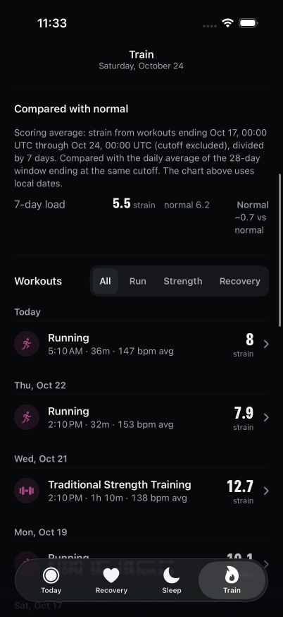
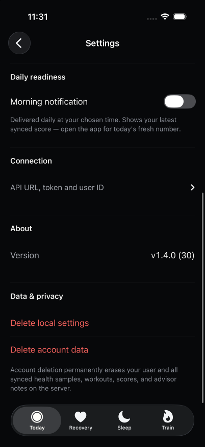
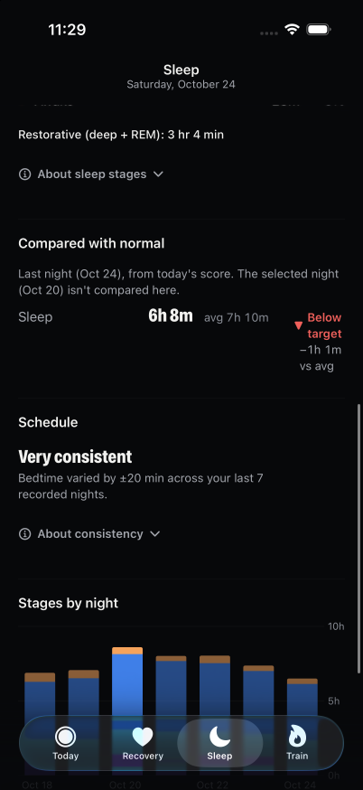
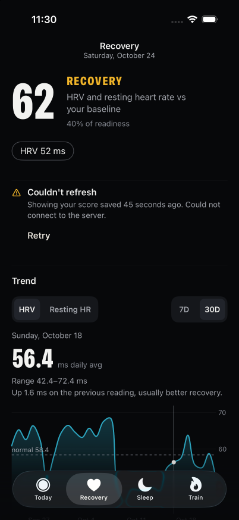

# Full redesign verification

All screenshots show synthetic local fixture data on an iPhone 17 Pro simulator. No production health data or credentials are included.

| Recovery | Sleep |
| --- | --- |
|  |  |

| Settings | Ask |
| --- | --- |
|  |  |

The assembled app passed 180 iOS tests. The final UTC caption change then passed all 23 affected pillar tests in the assembled checkout; the worker also passed 27 pillar and regression tests. The signed physical-device build succeeded and passed strict code-signature verification. Independent Sol reviews covered the assembled flow and approved the final UTC correction after all substantive findings were resolved.

Runtime checks exercised Recovery metric and range switching, date scrubbing, Sleep range and night selection, stage timeline updates, Train filtering and workout details, secure Settings fields, destructive confirmation dismissal and Ask using a local fixture response. Default and largest Dynamic Type layouts were inspected. Empty and failed-load responses were exercised on all three pillar tabs.

The original zero-distance drag and its first replacement both captured vertical swipes. The final direction-aware UIKit recognizers passed actual tap, horizontal scrub and vertical page-scroll checks on Sleep and Recovery. Selecting October 20 changed Sleep's duration and timeline; its comparison explicitly identified October 24 as the source.

With the local API stopped, a relaunched app retained cached Recovery, Sleep and Train data. Forcing a Today refresh while disconnected showed a saved-score warning above the still-healthy cached Recovery detail. Restarting the fixture and pressing Retry cleared the warning.

The device-control tools cannot drive the physical phone's Airplane Mode or HealthKit flow. Physical-phone offline behavior and a full Settings sync therefore remain unverified. Simulator cache checks do not establish those results. No backend deployment or merge was performed.
