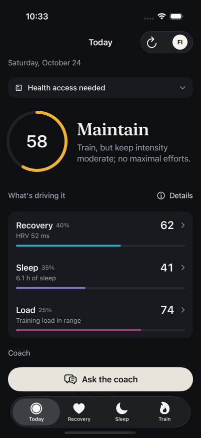
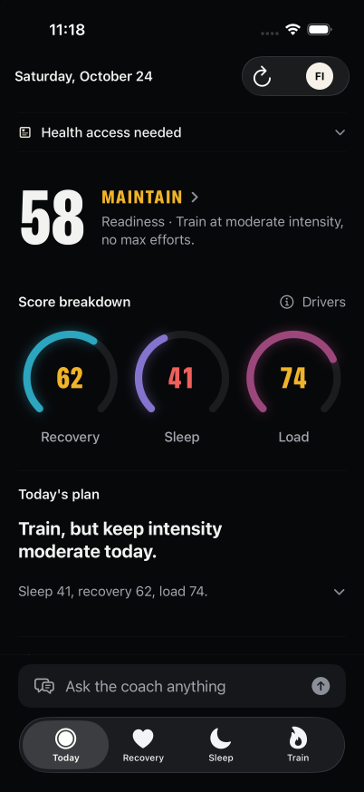
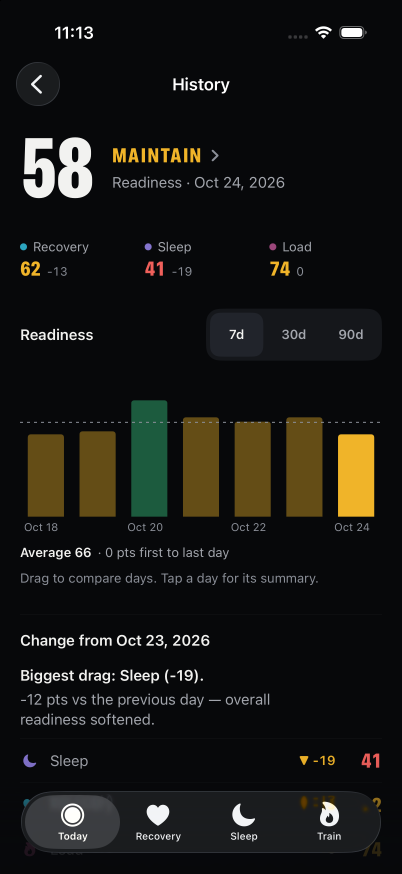
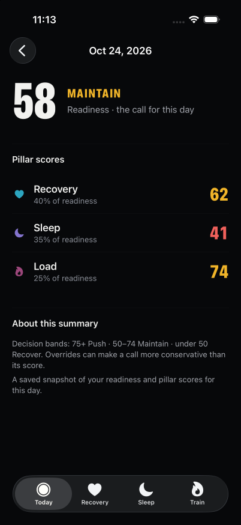

# Today and History verification

The screenshots use synthetic fixture data on an iPhone 17 Pro simulator at the same 402 × 874 size. The before and after Today screens both show readiness 58.

| Before | After |
| --- | --- |
|  |  |

At commit `38205da`, all 153 iOS tests, 97 backend unit tests and 13 backend integration tests passed. Independent source review approved `24c7732..38205da`. The backend and web GitHub checks passed on that revision.

Simulator checks exercised Today with normal, calibrating, low-confidence, pending, empty and error responses, plus the largest Dynamic Type size. Raw connection errors are behind a details disclosure. The full plan reasons remain reachable.

History's 7/30/90-day controls expose distinct accessibility labels. Selecting seven days changed the displayed chart to seven days. Opening the selected day's summary displayed saved scores and made no additional HTTP request, verified using a path-only local fixture request log.

The Better Design MCP was unavailable because its quota was exhausted; no MCP design approval is claimed. Physical-phone offline behavior and full HealthKit sync remain unverified. The remaining pillar and supporting screens are separate stack layers.
